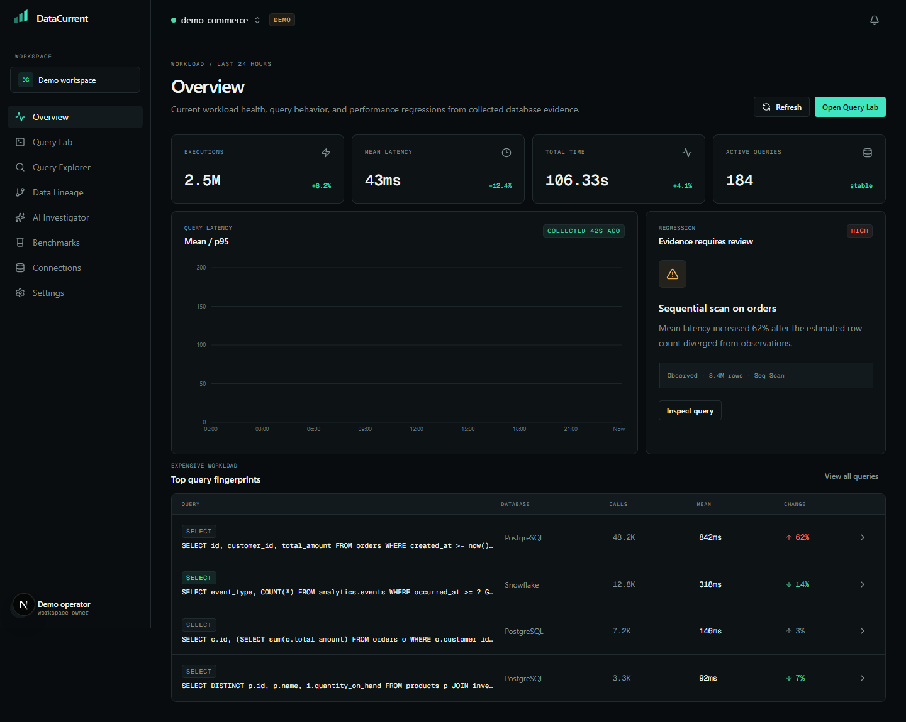
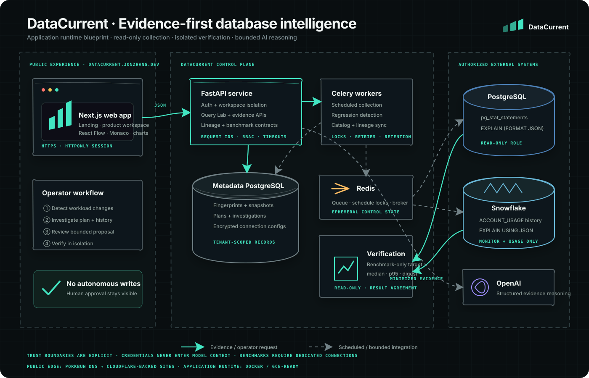

<div align="center">
  
  <p><strong>Evidence-first database performance intelligence for PostgreSQL and Snowflake.</strong></p>
  <p>Detect regressions. Investigate plans. Produce bounded recommendations. Verify the outcome.</p>

  <p>
    <a href="https://datacurrent.jonzhang.dev"></a>
    <a href="https://github.com/jonxsong/DataCurrent/actions/workflows/ci.yml"></a>
    <a href="https://github.com/jonxsong/DataCurrent/actions/workflows/containers.yml"></a>
  </p>
</div>



## Why DataCurrent

Database performance tools often stop at a chart, and AI tools often start guessing before they have enough evidence. DataCurrent joins the full investigation loop while keeping the distinction between observation, heuristic, hypothesis, and verified result explicit.

| Detect | Investigate | Recommend | Verify |
|---|---|---|---|
| Collect real workload statistics and identify regressions | Correlate history, structured plans, schema, indexes, and lineage | Generate cited, confidence-scored proposals with tradeoffs | Compare candidates in isolation with median, p95, and result agreement |

The product includes a polished landing experience, a working product workspace, production APIs, scheduled collectors, and a reproducible commerce workload. PostgreSQL and Snowflake are first-class providers—not visual placeholders.

**[Visit the public product site →](https://datacurrent.jonzhang.dev)**

## Product surfaces

- **Workload overview** — current health, regressions, latency trends, and expensive fingerprints.
- **Query Explorer** — redacted normalized SQL, historical metrics, provider context, and evidence state.
- **Query Lab** — read-only plan analysis with Monaco and structured plan findings.
- **AI Investigator** — OpenAI Agents SDK, narrow evidence tools, typed output, citations, confidence, and limitations.
- **Data Lineage** — catalog-backed and parsed relationships with evidence classification.
- **Benchmarks** — isolated, repeated comparison with result digests and visible methodology.
- **Connections** — encrypted PostgreSQL and Snowflake configuration with capability checks.
- **Operations** — Celery scheduling, Redis locks, retention, request IDs, health checks, and Docker packaging.

## Architecture



The control plane never sends database credentials or arbitrary row data to the model. Database connections are encrypted at rest, collection uses read-only roles, AI receives minimized authorized evidence through narrow tools, and empirical verification requires an explicitly marked benchmark connection.

The public product surface is served at **[datacurrent.jonzhang.dev](https://datacurrent.jonzhang.dev)** through Porkbun-managed authoritative DNS and the Cloudflare-backed Sites edge. The containerized application runtime is a separate deployment surface, so the public experience remains available without placing the database control plane in the request path.

Read the [architecture](docs/architecture.md), [security model](docs/security.md), and [operations guide](docs/operations.md).

## Run it locally

Requirements: Docker Desktop with Compose v2. That is enough for the full stack.

```bash
git clone https://github.com/jonxsong/DataCurrent.git
cd DataCurrent
cp .env.example .env.local
docker compose up --build
```

Then open:

- Product: `http://localhost:3000`
- API health: `http://localhost:8000/api/v1/healthz`
- OpenAPI: `http://localhost:8000/docs`
- Seeded demo PostgreSQL: `localhost:55432`

The included demo database enables `pg_stat_statements` and creates deterministic customers, products, orders, payments, inventory, and event data. Five intentionally interesting scenarios live in [`benchmarks/scenarios`](benchmarks/scenarios).

For AI investigations, set `OPENAI_API_KEY` in `.env.local`. Never commit that file. The rest of DataCurrent continues to work without an API key.

## Snowflake

DataCurrent uses the official Snowflake Python connector and supports:

- encrypted connection configuration and a bounded connectivity test;
- `SNOWFLAKE.ACCOUNT_USAGE.QUERY_HISTORY` workload collection;
- `INFORMATION_SCHEMA` catalog discovery;
- read-only `EXPLAIN USING JSON` in Query Lab;
- provider-aware lineage and isolated benchmark execution.

The recommended role grants only warehouse usage, database/schema usage, imported privileges on the `SNOWFLAKE` database, and the minimum object privileges needed for catalog inspection. See the exact setup SQL and validation steps in the [Snowflake guide](docs/snowflake.md).

## Development

```bash
# JavaScript dependencies
corepack enable
pnpm install --frozen-lockfile

# Python environment (Python 3.12)
uv sync --frozen --all-packages --group dev

# Complete local quality gate
uv run ruff format --check apps/api workers/collector
uv run ruff check apps/api workers/collector
uv run pytest apps/api/tests -q
pnpm --filter @datacurrent/web lint
pnpm --filter @datacurrent/web typecheck
pnpm --filter @datacurrent/web test
pnpm --filter @datacurrent/web build
pnpm --filter @datacurrent/web test:e2e
```

CI runs the same Python, TypeScript, unit, browser, and image-build checks. Dependabot maintains npm, uv, Docker, and GitHub Actions dependencies.

## Production

The public product site is live on the custom domain through the no-cost Sites edge. The production profile for the full application runs the real Next.js, FastAPI, Celery, PostgreSQL, and Redis services behind automatic HTTPS; its Google Compute Engine rollout is deployment-ready but intentionally deferred until cloud compute is desired. See the [deployment guide](docs/production-deployment.md) for provisioning, secrets, DNS, backups, verification, and rollback.

## Repository map

```text
apps/api/                 FastAPI control plane, connectors, analysis, AI, migrations
apps/web/                 Next.js landing page and application workspace
workers/collector/        Celery collection, retention, and regression jobs
infrastructure/docker/    Reproducible PostgreSQL development environment
infrastructure/deployment/ Hardened HTTPS production deployment
benchmarks/scenarios/     Deterministic workload investigations
docs/                     Architecture, security, Snowflake, and operations
site-preview/             Public .chatgpt.site source package
```

## Design principles

1. **Evidence before explanation.** Every factual finding cites its source.
2. **Read-only by construction.** Privileges, parsing, timeouts, host policy, and isolated targets enforce the boundary.
3. **AI proposes; people decide.** The model cannot execute schema changes.
4. **Measurement is labeled.** Cumulative statistics are not presented as traces, and a recommendation is not a performance claim.
5. **Verification changes the status.** Measured results, result agreement, environment, and method remain attached to the proposal.

---

<div align="center">
  <sub>Built for teams that want database answers they can defend.</sub>
</div>

